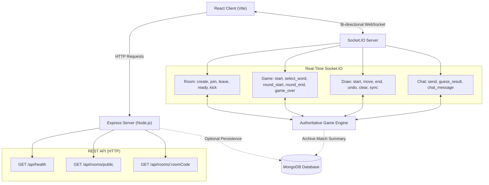
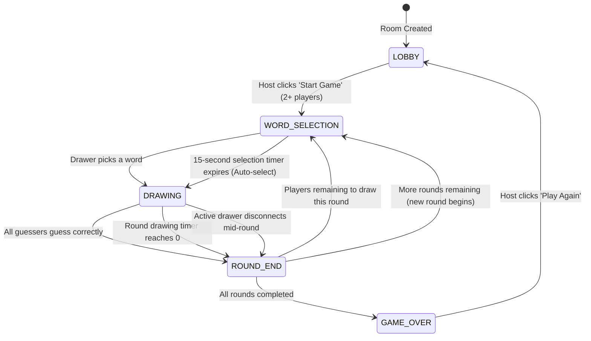

# Sketchly System Architecture

Sketchly is a real-time, server-authoritative multiplayer drawing and guessing game built with modern web technologies. This document provides an exhaustive breakdown of the system design, directory structure, data flow, authority model, and security mechanisms.

---

## 1. High-Level Design Principles

1. **Strict Two-Tier Architecture:** The project consists exclusively of two standalone application directories:
   - `client/` (Frontend React + Vite + TypeScript application)
   - `server/` (Backend Node.js + Express + Socket.IO + MongoDB service)
   There is no separate `shared/` package or hidden workspace link. Type contracts and constants are mirrored and maintained cleanly according to domain ownership.
2. **Server Authoritativeness:** The client is purely a rendering and input interface. The server holds full authority over:
   - Room existence and member rosters
   - Player scores and turn rotations
   - Word selection and private answer validation
   - Match timer countdowns and phase transitions
   - Stroke validation and broadcast distribution
3. **Bandwidth Efficiency:** Canvas artwork is transmitted as batched normalized vector strokes, rather than heavy bitmap images, enabling 60fps real-time drawing with minimal network overhead.
4. **Information Security:** The secret word is strictly masked on the server. Non-drawers never receive the secret answer over Socket.IO until the turn concludes.

---

## 2. Directory Layout

```text
game/
│
├── client/                     # Frontend Application
│   ├── src/
│   │   ├── components/         # Reusable UI components
│   │   │   ├── common/         # Button, Input, Modal, Avatar, Badge
│   │   │   └── layout/         # Navbar, Footer
│   │   ├── constants/          # UI constants, color palettes, brush sizes
│   │   ├── features/           # Feature-driven screen views
│   │   │   ├── home/           # Landing page & public room browser
│   │   │   ├── create/         # Room configuration & setup form
│   │   │   ├── join/           # Direct code join entry
│   │   │   ├── lobby/          # Pre-game lobby & player ready roster
│   │   │   └── game/           # Main canvas, toolbar, scoreboard, chat HUD
│   │   ├── services/           # Socket.IO client instance & Web Audio synthesizer
│   │   ├── socket/             # Client-side typed Socket.IO event contracts
│   │   ├── types/              # Frontend view models and state interfaces
│   │   ├── utils/              # Normalized coordinate transforms
│   │   ├── App.tsx             # Route definitions & router provider
│   │   ├── main.tsx            # Application bootstrap
│   │   └── index.css           # Tailwind base, dark arcade arena background
│   ├── index.html              # HTML shell & font preloading
│   ├── package.json            # Client dependencies & scripts
│   ├── tsconfig.json           # Client TypeScript configuration
│   ├── vite.config.ts          # Vite build pipeline & reverse proxy
│   └── tailwind.config.js      # Game theme, tactile shadows, color palette
│
├── server/                     # Backend Service
│   ├── src/
│   │   ├── config/             # Environment parsing & validation (env.ts)
│   │   ├── constants/          # Scoring parameters, time limits, default rules
│   │   ├── data/               # 250+ Curated words dataset across 8 categories
│   │   ├── game/               # Object-Oriented Game Engine
│   │   │   ├── Player.ts       # Player state, session tracking, score calculations
│   │   │   ├── Game.ts         # Match state machine, turn queues, timers, hints
│   │   │   ├── Room.ts         # Room lifecycle, host authority, socket rooms
│   │   │   └── GameManager.ts  # Room registry, room code generator, room garbage collection
│   │   ├── models/             # Mongoose schemas (Room, GameSession)
│   │   ├── routes/             # REST API endpoints (/api/health, /api/rooms)
│   │   ├── socket/             # Real-time WebSocket handlers
│   │   │   ├── events.ts       # Server-side typed Socket.IO event contracts
│   │   │   ├── drawHandler.ts  # Stroke validation, undo, clear, and broadcast
│   │   │   ├── chatHandler.ts  # Guess normalization, scoring, proximity whispers
│   │   │   └── socketHandler.ts# Connection lifecycle, room join/leave routing
│   │   ├── types/              # Backend domain interfaces & state snapshots
│   │   ├── utils/              # Levenshtein distance, string sanitization
│   │   └── server.ts           # Express HTTP server + Socket.IO initialization
│   ├── tests/                  # Automated test suite (Vitest)
│   │   ├── game.test.ts        # Unit tests for Game engine & scoring logic
│   │   ├── room.test.ts        # Unit tests for Room & Player management
│   │   └── integration.test.ts # E2E Socket.IO multiplayer flow tests
│   ├── package.json            # Server dependencies & scripts
│   └── tsconfig.json           # Server TypeScript configuration
│
├── docs/                       # Project Documentation Suite
│   ├── ARCHITECTURE.md         # This document
│   ├── SOCKET_SPECIFICATION.md # Comprehensive WebSocket event dictionary
│   ├── GAME_ENGINE.md          # State machine, scoring, hints & proximity
│   ├── FRONTEND_CANVAS.md      # HTML5 Canvas engine & Web Audio synthesizer
│   └── SETUP_AND_TESTING.md    # Local setup, testing & verification guide
│
├── .gitignore                  # Git ignore rules
├── package.json                # Root package for workspace orchestration
└── README.md                   # Project overview and quickstart guide
```

---

## 3. Communication Architecture: REST vs Socket.IO

The application establishes a clear separation of concerns between HTTP REST endpoints and persistent WebSockets.



### When to use REST:
- **Service Health Monitoring:** `GET /api/health` reports server uptime, active rooms, and database connectivity.
- **Public Lobby Listing:** `GET /api/rooms/public` allows users on the homepage to discover open rooms without establishing a WebSocket connection first.
- **Room Metadata Lookups:** `GET /api/rooms/:roomCode` verifies room existence and player capacity before navigating.

### When to use Socket.IO:
- Real-time room joining, player readiness, and host transfers.
- Real-time turn progression, countdown timer synchronization, and round conclusions.
- Low-latency vector stroke transmission and canvas canvas synchronization.
- Real-time guess processing, proximity calculations, and anti-spoiler chat routing.

---

## 4. Authoritative State Machine & Turn Lifecycle

Match flow follows a strict finite state machine executed entirely by the `Game` class:



### State Explanations:
1. **`LOBBY`:** Players join, choose avatars and display names, adjust match rules (rounds, draw time, word choices, hints, custom words), and mark themselves "Ready".
2. **`WORD_SELECTION`:** The server selects a designated number of random words (default: 3) from the configured category. The active drawer has 15 seconds to select one. Other players see a waiting screen. If the drawer does not choose in time, the server auto-selects a word.
3. **`DRAWING`:** The timer counts down from the configured draw time (default: 75s). The drawer draws on the canvas; other players type guesses into the chat. The server computes hints at designated milestones. The turn ends when time runs out or when all active guessers succeed.
4. **`ROUND_END`:** The secret word is revealed to all players. Points earned during the turn are displayed on an animated summary modal. A 5-second intermission allows players to review results before the next turn begins.
5. **`GAME_OVER`:** Match finishes. Final scores are compiled into a 1st/2nd/3rd place podium. Players can review full match statistics and the host can reset the room back to `LOBBY`.

---

## 5. Security & Anti-Cheat Architecture

### 1. Secret Word Masking
The server ensures secret words are never transmitted to clients who should not have access to them:
```ts
// Server: Game.ts
public getSnapshot(requestingPlayerId?: string): GameStateSnapshot {
  const isDrawer = this.currentDrawerId === requestingPlayerId;
  const isRoundOver = this.phase === GamePhase.ROUND_END || this.phase === GamePhase.GAME_OVER;

  return {
    phase: this.phase,
    round: this.currentRound,
    totalRounds: this.settings.rounds,
    drawerId: this.currentDrawerId,
    // Secret word ONLY visible to drawer or after the turn ends
    selectedWord: (isDrawer || isRoundOver) ? this.selectedWord : null,
    // Word choices ONLY visible to drawer during WORD_SELECTION
    wordChoices: (isDrawer && this.phase === GamePhase.WORD_SELECTION) ? this.currentWordChoices : [],
    maskedWord: this.getMaskedWord(),
    wordLength: this.selectedWord ? this.selectedWord.length : 0,
    category: this.selectedCategory,
    timeRemaining: this.timerSeconds,
    totalDrawTime: this.settings.drawTime,
  };
}
```

### 2. Drawer Role Validation
Clients cannot forge draw events. Whenever a `draw:start`, `draw:move`, `draw:end`, `draw:undo`, or `draw:clear` event is received, `drawHandler.ts` verifies:
1. The socket's associated player exists in the room.
2. The current phase is `GamePhase.DRAWING`.
3. The socket's player ID matches `game.currentDrawerId`.
If any check fails, the event is silently discarded and never broadcast.

### 3. Anti-Spoiler Chat Isolation
When a player submits a correct guess:
1. They receive a private `guess:result` event notifying them of success and their awarded points.
2. The server broadcasts a public announcement: `"🎉 [Player] guessed the word!"` to the room without disclosing the answer.
3. The player is flagged with `hasGuessedCorrectly = true`.
4. Subsequent chat messages from this player are routed **only** to other players who have also guessed correctly, preventing them from spoiling the answer in public chat.

---

## 6. Persistence & Memory Model

- **Active Gameplay State (In-Memory):** All active games, rooms, player socket bindings, timers, and stroke histories live in high-performance server memory (`GameManager`). This ensures sub-millisecond event responses for real-time multiplayer drawing without database I/O bottlenecks.
- **Persistence (MongoDB / Mongoose):** 
  - Room metadata is optionally saved upon creation and updated upon completion.
  - Finished matches can be archived as `GameSession` records, tracking winning players, final scores, and match duration.
  - **Graceful Fallback:** If MongoDB is unavailable or no connection string is provided, the application runs entirely in memory without throwing unhandled exceptions.
