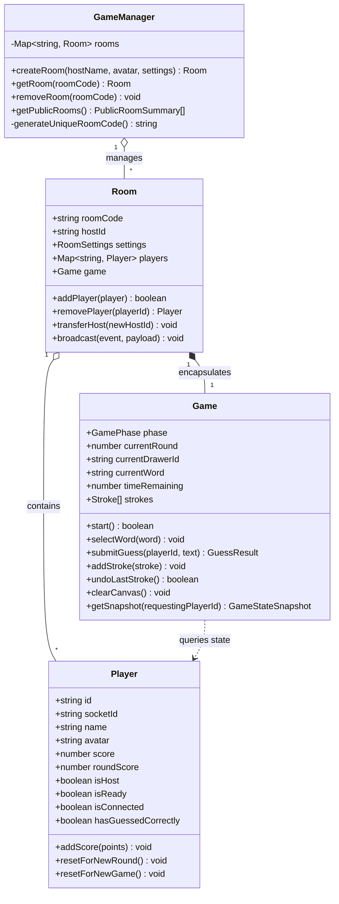

# Sketchly Game Engine & Rules

The Sketchly Game Engine is an Object-Oriented, server-authoritative state system designed for deterministic multiplayer drawing, turn rotations, hint sequencing, scoring algorithms, and guess proximity evaluation.

---

## 1. Core Classes & Responsibilities

The game backend is modularized into four primary domain entities:



### 1. `GameManager.ts`
- **Room Registry:** Maintains active rooms in an in-memory `Map<string, Room>`.
- **Code Generation:** Generates 6-character uppercase codes using an unambiguous alphanumeric charset (`ABCDEFGHJKLMNPQRSTUVWXYZ23456789`), excluding easily confused characters such as `0`, `O`, `1`, and `I`.
- **Lifecycle Cleaners:** Cleans up empty rooms automatically after all players disconnect.
- **Public Directory:** Exposes `getPublicRooms()` for real-time discovery on the homepage.

### 2. `Room.ts`
- **Membership & Host Authority:** Manages the player roster, maximum player limits, and readiness states.
- **Host Migration:** Automatically transfers host privileges to the next oldest connected player if the current host disconnects.
- **Socket.IO Room Delegation:** Emits events into the Socket.IO room channel (`room:${roomCode}`).

### 3. `Player.ts`
- **Identity & Socket Binding:** Tracks the player's persistent UUID, active Socket.IO connection ID, chosen avatar emoji, and display name.
- **Score Accumulator:** Maintains match total score alongside turn score delta (`roundScore`).
- **Turn Flags:** Manages `hasGuessedCorrectly`, `isReady`, and `isConnected`.

### 4. `Game.ts`
- **Turn Progression Machine:** Manages the 5 core game phases (`LOBBY`, `WORD_SELECTION`, `DRAWING`, `ROUND_END`, `GAME_OVER`).
- **Fair Turn Queue:** Shuffles connected players at match start to guarantee every player draws exactly once per round.
- **Authoritative Timers:** Operates asynchronous timers (`setInterval`) on the Node.js event loop for turn countdowns, selection limits, and intermissions.

---

## 2. Match Rules & Configuration Options

Rooms can be tailored with flexible match parameters:

| Parameter | Allowed Range | Default | Description |
|---|---|---|---|
| `maxPlayers` | 2 – 20 players | 8 | Upper limit on concurrent players in the lobby |
| `rounds` | 2 – 10 rounds | 3 | Total match cycles. Each round gives all players 1 turn to draw |
| `drawTime` | 15 – 240 seconds | 75s | Time allotted for each drawing turn |
| `wordCount` | 1 – 5 choices | 3 | Number of random secret words presented to the drawer |
| `hints` | 0 – 5 hints | 2 | Maximum letter hints revealed during a turn |
| `wordMode` | `Normal`, `Hidden`, `Combination` | `Normal` | Hint visibility behavior |
| `category` | `all`, or specific category | `all` | Dictionary filter |
| `customWords` | Array of strings | `[]` | User-submitted custom words injected into the pool |
| `isPublic` | `true` / `false` | `false` | Whether the room appears on the public homepage directory |

---

## 3. Scoring Engine & Equations

Points are awarded dynamically based on speed and accuracy.

### 1. Guesser Score (Time-Decay Formula)
When a non-drawer guesses the secret word, their score scales proportionally with the remaining time on the countdown:

$$\text{timeRatio} = \max\left(0.10, \frac{\text{timeRemaining}}{\text{totalDrawTime}}\right)$$

$$\text{basePoints} = \max\left(50, \text{round}\left(400 \times \text{timeRatio}\right)\right)$$

$$\text{awardedPoints} = \text{basePoints} + \begin{cases} 50, & \text{if first player to guess} \\ 0, & \text{otherwise} \end{cases}$$

- **Maximum Possible Score:** 450 points (fastest guesser at turn start).
- **Minimum Score Guarantee:** 50 points (even if guessed in the final second).

### 2. Drawer Score (Incentive Formula)
To encourage clear and communicative sketching, the drawer earns bonus points for every player who correctly solves their drawing:

$$\text{drawerBonus} = 40 \text{ pts per correct guesser}$$

If 5 players in the room guess the drawing, the drawer receives:

$$5 \times 40 = 200 \text{ bonus points}$$

---

## 4. Progressive Hint Engine

In `Normal` word mode, the server gradually reveals letter blanks without spoiling the word:

1. **Letter Mask Creation:** The word is initially converted into spaced underscores (e.g. `ELEPHANT` $\to$ `_ _ _ _ _ _ _ _`). Special characters (`-`, `'`, ` `) are preserved verbatim.
2. **Cap on Revealed Letters:** The engine enforces a strict cap:
   $$\text{maxRevealed} = \lfloor \text{lettersCount} \times 0.50 \rfloor$$
   No more than 50% of the word's letters can ever be revealed by hints.
3. **Milestone Schedule:** The server calculates time intervals based on the configured hint count:
   $$\text{interval} = \frac{\text{totalDrawTime}}{\text{configuredHints} + 1}$$
   For a 75-second turn with 2 hints, hints trigger at $t = 50\text{s}$ and $t = 25\text{s}$.
4. **Random Selection:** A random unrevealed letter index is selected, added to the revealed set, and broadcast as `game:hint`.

---

## 5. Guess Sanitization & Proximity Detection

Every guess submitted through `chat:send` passes through a multi-stage validation pipeline:

### 1. Sanitization & Normalization
```ts
public static normalize(text: string): string {
  return text
    .trim()
    .toLowerCase()
    .replace(/[.,\/#!$%\^&\*;:{}=\-_`~()]/g, '')
    .replace(/\s+/g, ' ');
}
```

### 2. Exact Match
If `normalize(guess) === normalize(targetWord)`:
- Award guesser points.
- Award drawer bonus.
- Flag player as solved.
- Check if all non-drawers have finished; if so, trigger early round completion.

### 3. Near-Miss Proximity Evaluation (Levenshtein Distance)
If the normalized guess does not match exactly, the engine computes the Levenshtein edit distance between the guess and target word:

```ts
// Calculate minimum single-character edits (insertions, deletions, substitutions)
const distance = Levenshtein.compute(normGuess, normTarget);

if (distance === 1 && normTarget.length >= 4) {
  // It is a near miss!
  // Send private whisper to guesser: "'[guess]' is very close!"
}
```

This prevents typos from demoralizing players while maintaining fairness.

---

## 6. Word Dataset & Categories

The backend ships with an embedded dictionary of 250+ categorized, family-safe words:

- **Animals:** `cat`, `dog`, `elephant`, `giraffe`, `penguin`, `kangaroo`, `octopus`, `chameleon`, etc.
- **Food:** `pizza`, `burger`, `sushi`, `pancake`, `ice cream`, `avocado`, `croissant`, `sandwich`, etc.
- **Objects:** `clock`, `laptop`, `guitar`, `umbrella`, `telescope`, `scissors`, `backpack`, `camera`, etc.
- **Nature:** `mountain`, `rainbow`, `volcano`, `waterfall`, `desert`, `lightning`, `island`, `glacier`, etc.
- **Actions:** `swimming`, `dancing`, `sleeping`, `painting`, `climbing`, `flying`, `cooking`, `singing`, etc.
- **Places:** `hospital`, `airport`, `castle`, `library`, `lighthouse`, `bakery`, `stadium`, `pyramid`, etc.
- **Professions:** `doctor`, `firefighter`, `astronaut`, `chef`, `detective`, `pilot`, `artist`, `scientist`, etc.
- **Technology:** `robot`, `drone`, `smartphone`, `satellite`, `rocket`, `keyboard`, `headphones`, `microscope`, etc.

Custom words provided in room settings are merged with the category pool during word selection.
